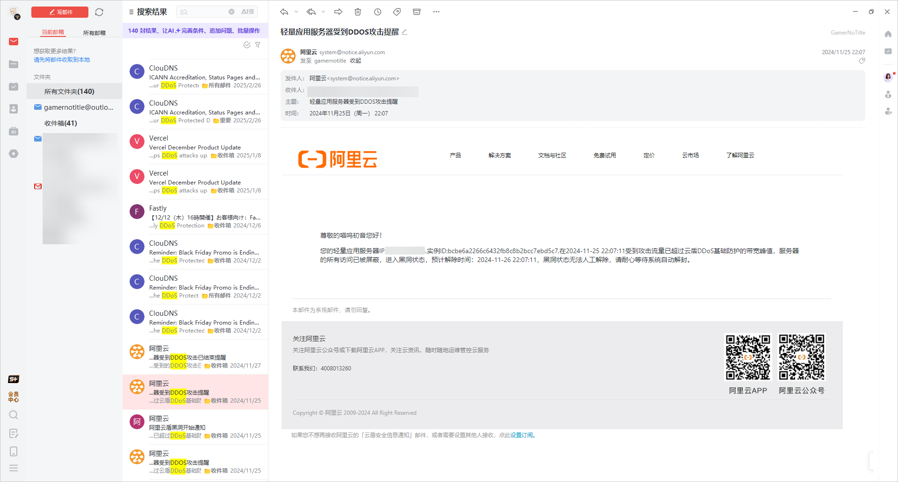

# 作业2

1. 学校考试试卷，英语四六级试卷，高考试卷，它们是否属于涉密数据，如果是分别对应什么样的安全级别？
2. 如果理解教材上的“完整性”安全目标，AI生成的数据是否是真实的，网上搜集资料，如何对AI生成的数据进行进行完整性鉴别？
3. 网上搜集有关（个人信息）隐私保护的资料，试论述隐私保护的发展历程。
4. 网上搜集有关DoS（DDos）相关资料，我们该如何预防或抵抗这类攻击？
5. 用md格式保存,存放于作业的根目录，文件名为 `作业2.md`

## 个人解答

1. 以上提及的各种试卷都是涉密数据，学校考试试卷属于机密级或者秘密级数据，四六级考试卷子和高考试卷是绝密级数据
2. 不是，AI 在推理合成的过程中可能对事实进行篡改；可以采用多维度分析，多来源交叉比对，经过权威数据库的数据进行验证的方式进行完整性鉴别
3. 最开始是美国学者 Smauel Warren 和 Louis Brandeis 发表了一篇《隐私权》的论文，提出后在美国的司法系统中就出现了隐私权相关的诉讼。在 20 世纪 60 年代的时候 William Prosser 将隐私权总结为了四种保护类型并用于美国的司法实践；随后欧洲各国也开始推进各种隐私权相关的规定，其中欧盟最经典的就是 GDPR 这部法律。我国在 1982 年为隐私权提供了相关的法律支撑，到了 2009 年《侵权责任法》规定了相关的内容和责任。随着现代社会发展进程的需要，《网络安全法》在 2017 年 6 月开始实行，并对网络服务运营者使用个人信息的过程提出具体要求。2020 年 5 月《民法典》把《侵权责任法》纳入其中。2021 年 9 月《数据安全法》开始施行，同年 11 月《个人信息保护法》开始施行，为个人信息保护形成专门立法，为个人信息保护奠定了良好的法律基础。
4. DDoS，也叫分布式拒绝服务攻击，目的不是破坏计算机系统，是让特定的服务在巨大压力下快速消耗资源以至于无法快速反应过来，从而实现让服务宕机的结果。在防御方面的话比较经典的是黑洞和流量这一套，作为之前被打过的人来说，这一块阿里云给我用的就是这一套，在最开始的时候进行流量清洗，放行正常的业务流量，但是到后面流量实在太大了，超过阈值了，就让服务器进入黑洞，直接禁止一切连接（包括我的 =-=）。此外一些防火墙可以阻断部分 DDoS 攻击，而企业级的交换机本身也具有一定的过滤功能。一些 WAF 产品也有，例如电信的亿安枢，实习的时候用过，也具有一定的能力去防御 DDoS 的攻击。

## References

- https://inf.qq.com/read/1057450626/14
- https://zh.wikipedia.org/wiki/%E9%98%BB%E6%96%B7%E6%9C%8D%E5%8B%99%E6%94%BB%E6%93%8A