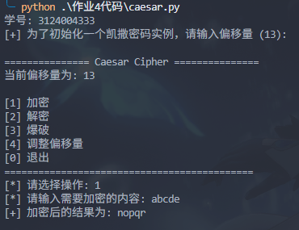
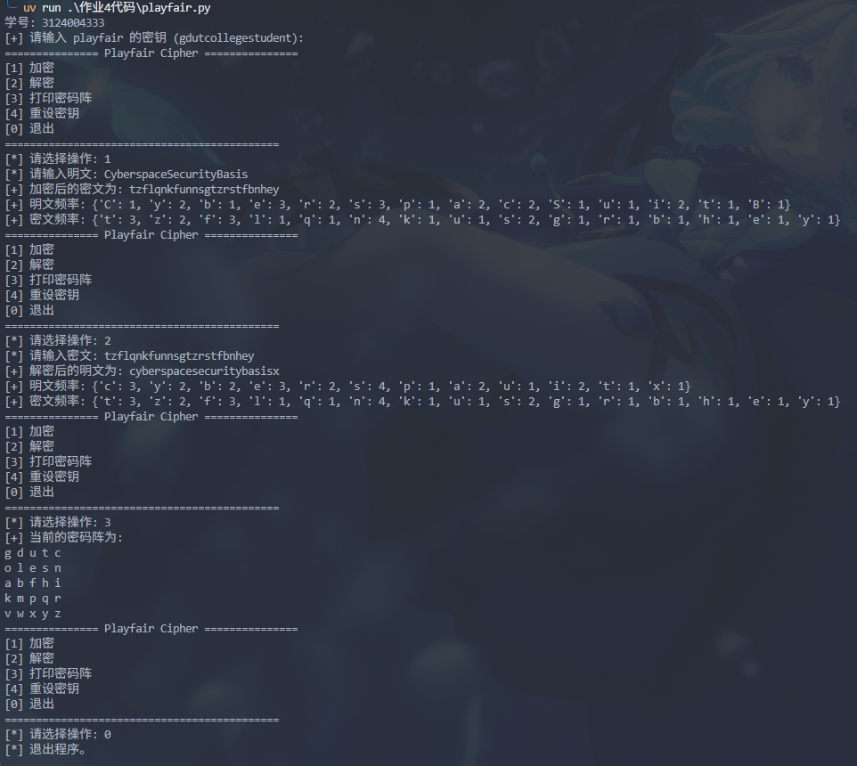

# 作业4

编程题目
Caesar密码算法。
1. 实现对数据文件的加密解密操作。
2. 实现显示加密前明文数据和加密后密文数据的字符出现频率统计。
3. 实现穷举攻击。
4. 具有较友好的用户界面
5. 源代码带有足够的注释，且必须是中文注释。

Playfair密码算法。
1. 只要求实现加密操作，建议在能力许可的范围内实现解密操作。
2. 显示加密前明文数据和加密后密文数据的字符出现频率统计。
3. 具有较友好的用户界面
4. 源代码带有足够的注释，且必须要有中注释。

说明 ：
1. 编程语言不作限制，可自由选择。
2. 一定要在项目的根目录中增加git忽略文件，防止项目中的临时文件增加到git库中。 参考服务器中（或网上搜索）忽略文件的书写格式。
3. 用户界面可以图形界面，也可以文本界面
4. 加密数据文件中的内容可以从外文资料或书籍中获取，不定限制。
5. 用md格式保存,存放于作业的根目录，文件名为 `作业4.md`

## 个人解答

### 凯撒密码

懒得写 GUI 了，就用简单的命令行提示了，代码在文件 [caesar.py](./作业4代码/caesar.py) 里面

### Playfair 密码

一样用命令行提示了，代码在文件 [playfair.py](./作业4代码/playfair.py)

